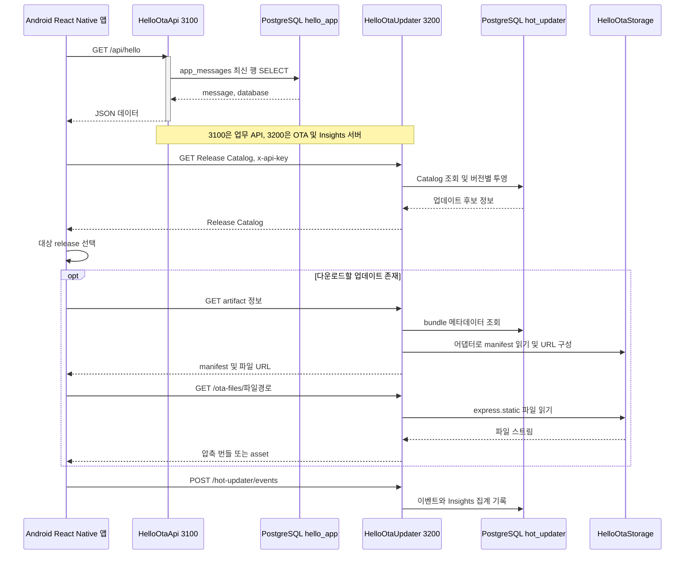
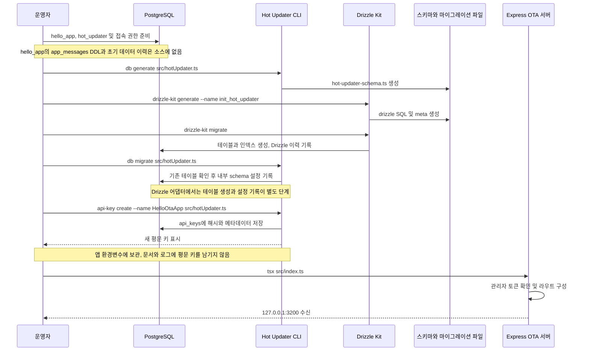
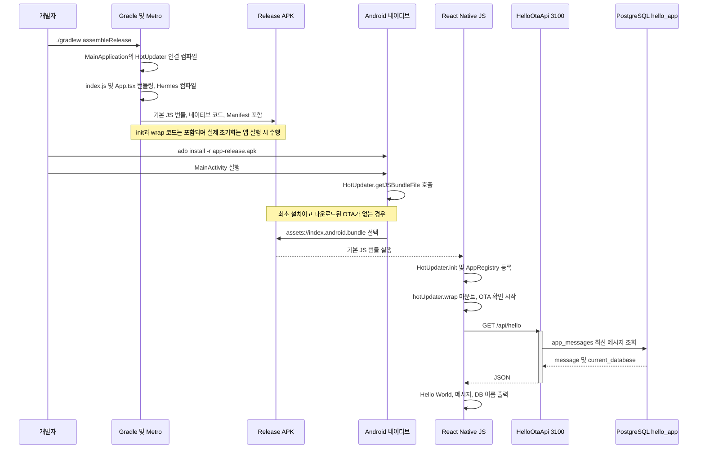
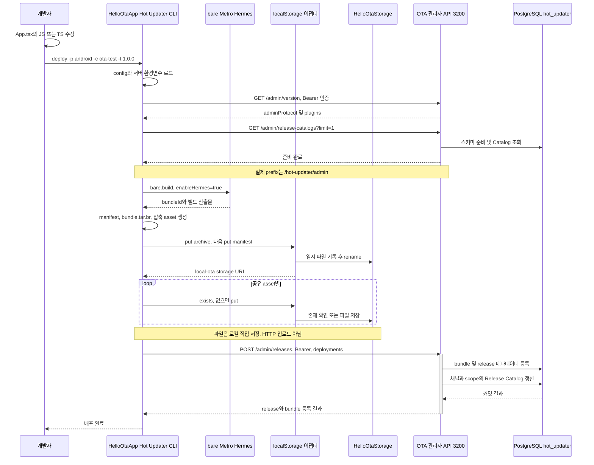
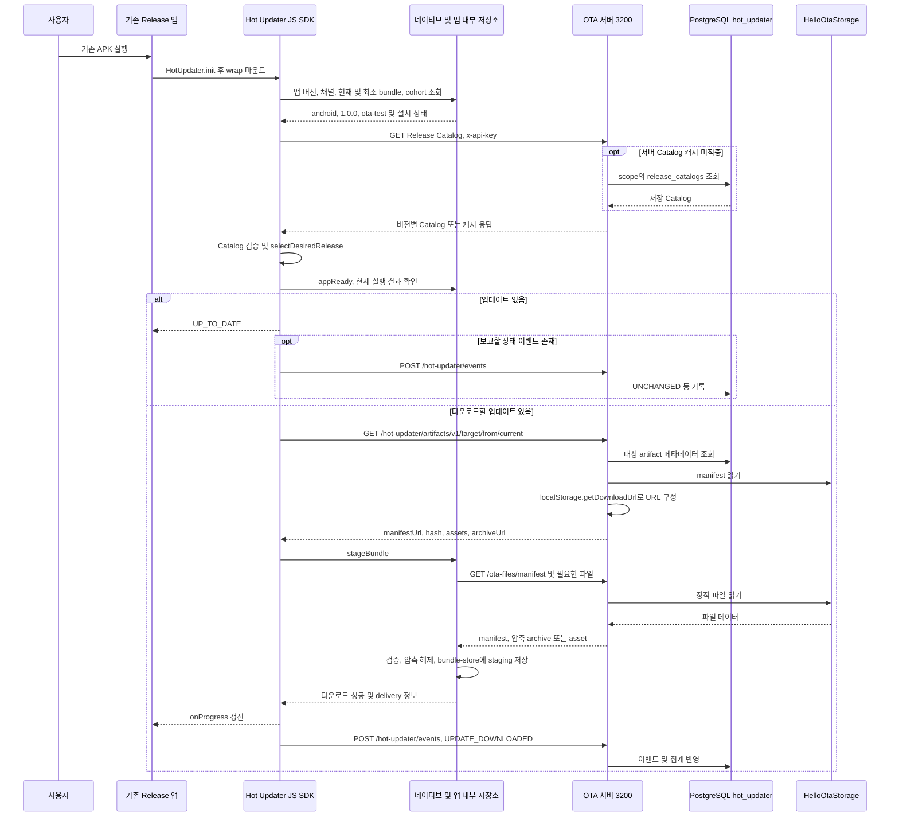
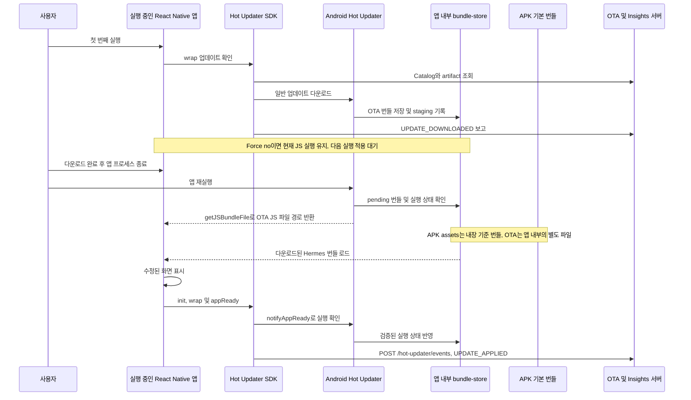
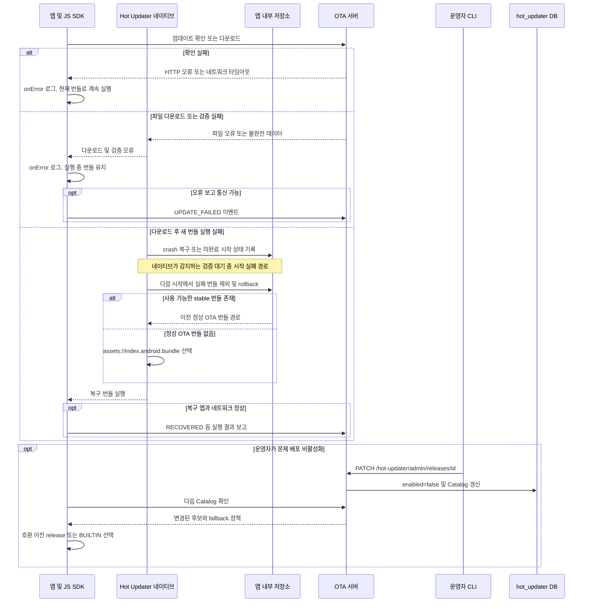

# Hello OTA 아키텍처와 배포 시퀀스

분석 기준: 2026-10-19, `/home/joon/work`의 실제 소스·설정 및 설치된 `node_modules` 구현. 이 문서는 초기 구성, APK 설치, 반복 OTA 배포를 분리하여 설명한다. 분석 과정에서는 패키지 설치, DB 변경, 서버 실행·재시작, APK 빌드·설치, OTA 배포를 수행하지 않았다. 아래 변경 명령은 향후 운영자가 실행할 절차다.

사용자가 제공한 구축 이력은 참고하되, 과거 오류 로그·명령 이력과 현재 DB 행, 단말 설치 상태는 확인하지 않았다. 따라서 파일에 존재하는 설정과 SDK의 지원 동작을 설명하며, 특정 배포의 현재 활성 상태나 성공 이벤트 수를 추정하지 않는다.

## 1. 실제 구성과 프로젝트별 역할

### 버전과 현재 앱 설정

| 항목 | 설치 파일에서 확인한 값 |
|---|---|
| React Native / React | 0.87.1 / 19.2.3 |
| Hot Updater CLI·RN SDK·bare·standalone·server | 1.0.3 |
| Express | API 5.2.1, Updater 5.3.0 |
| Drizzle ORM / drizzle-kit | 0.45.4 / 0.31.9 |
| TypeScript | App 6.0.3, API·Updater 7.0.2 |
| 일반 API PostgreSQL 드라이버 | `pg` 8.23.1 |
| OTA DB 드라이버 | `postgres` + `drizzle-orm/postgres-js` |
| PostgreSQL | 사용자 제공 환경은 18, 로컬 `/usr/lib/postgresql/18` 확인. 실행 중 DB 버전은 미조회 |
| Android applicationId | `com.hellootaapp` |
| Android versionCode / versionName | `1` / `1.0.0` |
| 기본 OTA 채널 | `ota-test` |
| 업데이트 전략 | 앱 wrapper와 CLI 설정 모두 `appVersion` |
| Android 실행 엔진 | `hermesEnabled=true`, `newArchEnabled=true` |

`package.json`의 `^1.0.3` 같은 허용 범위와 현재 설치된 정확한 버전은 구분해야 한다. 앱 npm 패키지 버전 `0.0.1`은 Android `versionName` 및 OTA 대상 앱 버전과 다르다.

### HelloOtaApp

- [`App.tsx`](HelloOtaApp/App.tsx): `GET http://10.0.2.2:3100/api/hello`로 데이터를 받고 메시지·DB 이름을 표시한다. 현재 제목은 `Hello World - HOTUPDATE SUCCESS`다. API 오류는 화면에 표시한다.
- [`src/hotUpdater.ts`](HelloOtaApp/src/hotUpdater.ts): `HotUpdater.init({baseURL, requestHeaders, plugins, onError})`로 인스턴스를 생성한다. `@env`의 `OTA_BASE_URL`, `HOT_UPDATER_API_KEY`를 사용하며 헤더는 `x-api-key`, 플러그인은 `insights()`다. 오류는 콘솔에 기록한다.
- [`App.tsx`](HelloOtaApp/App.tsx)의 기본 export는 `hotUpdater.wrap({updateStrategy: 'appVersion', onProgress, onUpdateProcessCompleted})(App)`이다. wrapper가 마운트될 때 업데이트 확인이 시작된다. 별도 fallback 화면은 지정하지 않아 앱 UI와 API 요청이 OTA 확인과 함께 진행될 수 있다.
- [`index.js`](HelloOtaApp/index.js)는 **감싼 App**을 `AppRegistry`에 등록한다. `init()`으로 인스턴스만 만드는 것과 wrapper가 자동 확인을 시작하는 것은 별개다.
- [`.env`](HelloOtaApp/.env)의 비밀이 아닌 URL은 `http://10.0.2.2:3200/hot-updater`다. [`babel.config.js`](HelloOtaApp/babel.config.js)의 `module:react-native-dotenv`가 빌드 시 환경변수를 JS에 반영한다. [`env.d.ts`](HelloOtaApp/env.d.ts)는 타입 선언이며 실제 값을 제공하지 않는다.
- [`hot-updater.config.ts`](HelloOtaApp/hot-updater.config.ts)는 `bare({enableHermes:true})`, 형제 프로젝트에서 가져온 `localStorage()`, `standaloneRepository()`를 연결한다. 관리자 주소는 `http://127.0.0.1:3200/hot-updater/admin`이고 `Authorization: Bearer …`를 사용한다. `../HelloOtaUpdater/.env`를 `process.loadEnvFile()`로 읽으며 관리자 토큰 누락 시 실패한다. CLI 플러그인은 `insights()`, `apiKeys()`다.
- [`MainApplication.kt`](HelloOtaApp/android/app/src/main/java/com/hellootaapp/MainApplication.kt)는 Release에서 `HotUpdater.getJSBundleFile(applicationContext)`를 React Host의 `jsBundleFilePath`에 전달한다. Debug에서는 `null`이다.
- [`AndroidManifest.xml`](HelloOtaApp/android/app/src/main/AndroidManifest.xml)은 INTERNET 권한, `usesCleartextTraffic="true"`, `com.hotupdater.CHANNEL="ota-test"`를 선언한다.
- [`android/app/build.gradle`](HelloOtaApp/android/app/build.gradle)은 버전·자동 링크·Hermes 의존성을 지정한다. 현재 Release도 debug 서명키를 사용하는 개발 검증 구성이다.

### HelloOtaApi

[`src/index.ts`](HelloOtaApi/src/index.ts)는 Express 일반 업무 API다. `.env`의 `PGHOST=127.0.0.1`, `PGPORT=5432`, `PGDATABASE=hello_app`을 사용하고, 연결 풀 최대 3개·연결 제한 3초를 설정한다. `127.0.0.1:3100`에서 수신한다.

`GET /api/hello`는 다음 SQL을 실행하고 첫 행을 JSON으로 반환한다.

```sql
SELECT message, current_database() AS database
FROM app_messages
ORDER BY id DESC
LIMIT 1;
```

행이 없으면 `{message:'데이터 없음', database:'hello_app'}`, DB 오류면 HTTP 500과 `Database query failed`를 반환한다. `app_messages` 생성·초기 데이터 SQL은 현재 프로젝트에서 찾지 못했으므로 임의의 테이블 정의를 제시하지 않는다. 이 서버에는 OTA 등록·다운로드·Insights 처리 코드가 없다.

### HelloOtaUpdater

[`src/index.ts`](HelloOtaUpdater/src/index.ts)는 `127.0.0.1:3200`에서 다음 순서로 라우트를 연결한다.

1. `/hot-updater` 요청 완료 시 메서드·경로·응답 상태 로그.
2. `GET /health`: 서비스 상태 JSON. DB 연결 성공을 검사하는 health check는 아니다.
3. `/ota-files`: `express.static(STORAGE_DIR)`로 파일 제공. dotfile 거부, 디렉터리 index 비활성화, 미존재 파일 fallthrough 비활성화.
4. `/hot-updater/admin`: Bearer 토큰 검사 → JSON 파서(1 MB) → `hotUpdater.handlers.admin`.
5. `/hot-updater`: JSON 파서(1 MB) → `hotUpdater.handlers.client`.

관리자 라우트가 먼저 등록되므로 클라이언트 처리기보다 우선한다. 토큰이 없으면 서버 시작 단계에서 실패하며, 불일치 요청은 401이다.

[`src/hotUpdater.ts`](HelloOtaUpdater/src/hotUpdater.ts)는 `createHotUpdater()`에 `drizzleAdapter({db, provider:'postgresql'})`, `localStorage()`, `insights()`, `apiKeys()`를 등록한다. [`src/drizzle.ts`](HelloOtaUpdater/src/drizzle.ts)는 `hot_updater` DB에 최대 3개의 `postgres` 연결을 사용한다. API 서버의 `hello_app`과는 별도 DB다.

[`drizzle.config.ts`](HelloOtaUpdater/drizzle.config.ts)는 `hot-updater-schema.ts` → `drizzle/` SQL 생성 경로와 PostgreSQL 접속 정보를 지정한다. 현재 `ssl:false`다. 런타임 `src/drizzle.ts`에는 명시적 SSL 설정이 없다.

### HelloOtaStorage와 localStorage 어댑터

이 디렉터리는 별도 HTTP 서버가 아니라 Ubuntu 파일 저장소다. 저장 루트는 `/home/joon/work/HelloOtaStorage/bundles`이고, [`localStorage.ts`](HelloOtaUpdater/src/localStorage.ts)를 CLI와 OTA 서버가 공유한다.

| 어댑터 동작 | 실제 구현 |
|---|---|
| `put` | 디렉터리 생성 → UUID 임시 파일에 스트림 기록(`wx`, 0600) → `rename` → storage URI 반환 |
| `get` | 파일을 Response 스트림으로 읽음. 없는 파일은 `response:null` |
| `exists` | `stat`으로 일반 파일 존재 확인 |
| `getDownloadUrl` | URI key를 경로 단위로 인코딩하여 `OTA_DOWNLOAD_BASE_URL`에 연결 |
| `delete` | 해당 파일 삭제 |
| 경로 제한 | 프로토콜·bucket 검증 및 저장 루트 밖으로 벗어나는 파일 경로 거부 |

**배포 CLI가 같은 머신의 파일시스템에 직접 쓴다. HTTP 업로드 API로 파일을 보내는 구성이 아니다.** CLI를 다른 머신에서 실행하려면 같은 저장소 접근을 마련하거나 어댑터를 바꿔야 한다.

```text
HelloOtaStorage/bundles/                  # OTA_STORAGE_DIR
├── bundles/<bundle-id>/manifest.json
├── bundles/<bundle-id>/bundle.tar.br
└── assets/sha256/<앞 2자리>/<hash>.br
```

저장 루트 아래에 `bundles/`가 한 번 더 붙는 것은 CLI의 key 규칙 때문이다. manifest에는 `index.android.bundle`, 원본·다운로드 크기와 해시, archive 정보가 들어 있다. 설정상 Hermes 빌드이며, 이 조사에서 압축 파일을 실행해 검증하지는 않았다.

- 내부 저장 식별자 예: `local-ota://bundles/bundles/<bundle-id>/manifest.json`
- 앱 다운로드 URL 예: `http://10.0.2.2:3200/ota-files/bundles/<bundle-id>/manifest.json`
- 공유 asset URL 예: `http://10.0.2.2:3200/ota-files/assets/sha256/<prefix>/<hash>.br`

서버 저장소와 **Android 앱 내부 저장소**는 서로 다르다. SDK는 단말의 `context.filesDir/bundle-store`에 번들·상태를 보관하고, 일부 설치별 상태는 `noBackupFilesDir/hot-updater`를 사용한다.

## 2. DB 테이블과 HTTP 계약

[`hot-updater-schema.ts`](HelloOtaUpdater/hot-updater-schema.ts)와 [`drizzle/0000_init_hot_updater.sql`](HelloOtaUpdater/drizzle/0000_init_hot_updater.sql)에서 확인한 주요 테이블이다. 이는 스키마 파일의 증거이며 실제 DB에 적용되었는지 이번 분석에서 조회하지 않았다.

| DB | 테이블 | 역할 |
|---|---|---|
| `hello_app` | `app_messages` | 일반 API가 `id`, `message`를 조회 |
| `hot_updater` | `bundles` | 플랫폼, manifest URI·해시, asset base URI, git·앱 메타데이터 |
| 동일 | `releases` | bundle 연결, 채널, 전략, 대상 버전, enabled, force, rollout, revision |
| 동일 | `channels` | 채널 ID·이름 |
| 동일 | `release_catalogs` | scope별 catalog ID·generation·payload·hash·tombstone |
| 동일 | `bundle_patches`, `bundle_totals` | 차분 파일 메타데이터, 번들 집계 |
| 동일 | `api_keys` | 키 해시·이름·prefix·role·생성/폐기 시각. 평문 키 저장 구조가 아님 |
| 동일 | `bundle_events`, `bundle_event_heads`, `bundle_events__byBundle` | 이벤트 원장, 설치별 최근 상태, 조회 인덱스 테이블 |
| 동일 | `insights_*` | overview, outcomes, failures, distribution, latest_by_bundle, sketches 등의 집계 |
| 동일 | `private_hot_updater_settings` | `schema.engine`, `schema.core`, `schema.insights`, `schema.apiKeys` 등 스키마 호환 설정 |

Core 설정은 `schema.engine=1`, `schema.core=1.0.0`이고 현재 두 플러그인의 스키마 버전도 `1.0.0`이다. npm 패키지 버전 `1.0.3`과 스키마 버전을 혼동하지 않는다. Drizzle 이력은 별도 기본 `drizzle.__drizzle_migrations` 테이블로 관리된다.

| 메서드 | 전체 경로 | 용도·인증 |
|---|---|---|
| GET | `:3100/api/hello` | 일반 데이터 조회, 현재 별도 인증 없음 |
| GET | `:3200/health` | 정적 서비스 응답 |
| GET | `/hot-updater/release-catalogs/app-version/android/b3RhLXRlc3Q/1.0.0` | 현재 앱의 Catalog 요청, `x-api-key` |
| GET | `/hot-updater/artifacts/v1/<targetBundleId>/from/<currentBundleId>` | manifest·asset·archive 다운로드 정보, `x-api-key` |
| POST | `/hot-updater/events` | Insights 이벤트 수집, `x-api-key`, 성공 204 |
| GET | `/ota-files/<key>` | 정적 파일 다운로드. 현재 인증 미들웨어 적용 안 됨 |
| GET | `/hot-updater/admin/version` | 관리자 프로토콜·플러그인 확인, Bearer |
| GET | `/hot-updater/admin/release-catalogs` | Catalog 목록·배포 전 준비 점검, Bearer |
| GET | `/hot-updater/admin/channels` | 채널 조회, Bearer |
| GET | `/hot-updater/admin/bundles`, `/hot-updater/admin/releases` | artifact·release 목록, Bearer |
| POST | `/hot-updater/admin/releases` | `{deployments:[{bundle,release}]}` 등록, Bearer |
| PATCH | `/hot-updater/admin/releases/<releaseId>` | `{patch, expectedRevision?}` 정책·enabled 수정, Bearer |
| GET | `/hot-updater/admin/events`, `/hot-updater/admin/overview`, `/hot-updater/admin/failures` | Insights 조회, Bearer |
| GET | `/hot-updater/admin/installations/<installId>` | 설치별 상태, Bearer |

3200 생략 경로는 OTA 서버 기준이다. `b3RhLXRlc3Q`는 `ota-test`의 base64url channel key다. Catalog는 앱 버전에 맞는 정보를 서버에서 투영하지만, **최종 대상 선택은 앱 SDK**가 현재 번들·최소 번들·cohort·crash history와 Catalog를 비교해 수행한다. 단순히 “서버가 최신 번들 하나를 골라 반환한다”는 흐름과 다르다.

## 3. 다이어그램 1 — 전체 시스템과 통신



두 서버는 서로를 호출하지 않는다. 앱이 일반 API와 OTA 서버를 각각 호출하며, DB·파일 저장소에 직접 접속하지 않는다. 에뮬레이터에서는 호스트를 `10.0.2.2`, 호스트 프로세스에서는 `127.0.0.1`로 접근한다.

## 4. 다이어그램 2 — 최초 환경 구성과 DB 초기화



API 키 생성은 서버 정의를 직접 로드하여 DB를 사용하므로 HTTP 서버 시작 전에 가능하다. Drizzle 테이블만 만들고 Hot Updater 설정 기록을 생략하면 스키마 준비 검사에서 실패할 수 있다. 이 절차는 **초기 구축 또는 스키마 변경 시** 수행한다. JS/TS를 반복 배포할 때마다 DB 생성·마이그레이션·키 생성을 반복하지 않는다. 현재 파일에서 복원한 절차이며 과거 실행 순서를 입증하는 로그는 아니다.

## 5. 다이어그램 3 — 최초 Android Release APK 빌드와 실행



APK 설치는 네이티브 실행 환경과 기본 번들을 설치하는 과정이다. OTA 다운로드는 이미 설치된 앱이 JS/asset을 받아 앱 내부 저장소에 추가하는 별도 과정이다. `adb install -r`는 기존 앱 데이터를 유지할 수 있으므로, 재설치가 항상 “OTA가 없는 최초 실행”을 재현하지는 않는다.

## 6. 다이어그램 4 — OTA 번들 빌드와 배포



필수 쓰기 순서는 **archive → manifest → 공유 asset 존재 확인/저장 → 관리자 등록 요청**이다. 준비 확인 HTTP 요청은 파일 빌드보다 앞선다. 등록 body에는 플랫폼·git 정보·manifest URI/해시·asset base URI와 채널·대상 버전·enabled·force·rollout 정책이 들어간다. CLI는 PostgreSQL에 직접 등록하지 않고 standalone 관리자 API를 호출한다.

`bundles`는 파일 artifact, `releases`는 그 artifact의 배포 정책이며 ID가 같은 개념은 아니다. Catalog는 DB에 저장되는 배포 정책의 투영이다. 파일시스템과 DB는 하나의 트랜잭션이 아니므로 파일 저장 성공 후 관리자 등록 실패 시 참조되지 않는 파일이 남을 수 있다. 업로드 중 임시 파일 정리는 어댑터가 수행하지만 전체 배포의 파일 정리를 보장하는 코드는 아니다.

일반 배포는 `--force-update`를 생략한다(기본 false). `--channel` 기본값은 `production`이므로 현재 앱에는 반드시 `-c ota-test`를 지정한다. 프로젝트는 patch 옵션을 직접 지정하지 않으며, 저장소에서 차분 파일은 확인하지 못했다. 위 도식은 확인된 기본 artifact 배포 경로다.

## 7. 다이어그램 5 — 앱 실행 시 확인과 다운로드



SDK는 Catalog의 scope·세대·해시와 설치 상태를 검증하고 crash history를 선택에 반영한다. 서버는 Catalog를 메모리에 최대 5초 캐시하며 ETag/304를 지원한다. 따라서 매 실행마다 DB를 반드시 다시 조회하는 것은 아니다. Catalog가 없는 정상 scope는 지정 헤더가 있는 404를 “업데이트 없음”으로 처리하지만 잘못된 URL의 일반 404는 같은 의미가 아니다.

네이티브는 전달 정보와 로컬 캐시에 따라 archive 또는 필요한 asset을 사용한다. 항상 `bundle.tar.br` 하나만 받는다고 단정할 수 없다. 다운로드 성공 이벤트는 **실행 성공**을 뜻하지 않는다. 일반 업데이트의 `onUpdateProcessCompleted`는 백그라운드 다운로드 완료를 기다리지 않고 호출될 수 있으므로 완료 판정에 이 로그 하나만 사용하면 안 된다.

## 8. 다이어그램 6 — 일반 업데이트 적용과 재실행



`Force: no`에서는 wrapper가 다운로드 후 자동 reload하지 않는다. 단순히 홈 화면으로 나갔다가 복귀하는 것과 프로세스를 종료한 뒤 새로 실행하는 것은 다르다. 검증할 때는 다운로드 완료 후 `adb shell am force-stop`으로 프로세스를 종료하고 다시 실행한다. 다운로드 도중 종료하면 staging이 완료되지 않을 수 있다.

이 시퀀스는 최초에는 기본 APK 번들, 이후에는 OTA 번들을 로드하는 경우다. 이미 OTA가 적용된 앱은 그 OTA를 실행하면서 다음 업데이트를 받는다. `--force-update` 배포는 SDK 기본 `reloadOnForceUpdate=true`에 따라 성공적으로 다운로드한 후 reload하는 별도 경로다. `appReady`는 SDK의 시작 확인이며 업무 API 응답이나 모든 화면 기능이 정상임을 보증하는 검사는 아니다.

## 9. 다이어그램 7 — 오류 처리와 복구



지원 범위는 다음과 같다.

| 기능 | 현재 지원과 한계 |
|---|---|
| 확인 실패 | SDK가 예외를 처리하고 앱의 `onError`를 호출한다. 현재 번들로 계속 진행한다. 이 경우 wrapper의 `UP_TO_DATE` 로그만으로 네트워크 확인 성공을 판단하면 안 된다 |
| 파일 실패 | 네이티브 다운로드·해시 검증·staging 실패를 SDK가 보고한다. 현재 앱은 별도의 재시도 버튼·오류 화면을 구현하지 않았다 |
| 시작 실패 롤백 | 설치된 Android SDK의 `prepareLaunch`, `rollbackPendingBundle`, crash recovery가 구현되어 있다. 검증 대기 번들의 crash 및 완료되지 않은 시작을 감지하여 stable 또는 기본 번들로 복구한다 |
| 기본 APK fallback | `getFallbackBundleURL()`은 `assets://index.android.bundle`. 사용 가능한 정상 OTA가 없을 때 사용한다 |
| 실패 번들 재선택 방지 | SDK crash history와 Catalog selector가 연동된다 |
| 서버 배포 비활성화 | CLI `bundle disable`이 release 정책을 변경하고 Catalog를 갱신한다. 파일 삭제나 단말에서 실행 중인 JS를 즉시 중단하는 동작은 아니다 |
| 서버에 의한 복귀 | 클라이언트가 새 Catalog를 받아 선택할 때 호환 후보 또는 BUILTIN으로 전환할 수 있다. force 정책과 다음 실행 시점에 따라 적용 시점이 다르다 |
| Insights 재시도 | SDK sender는 네트워크 오류·429·5xx에 최대 3회 시도한다. 오프라인 상태에서 모든 이벤트의 영구 보존·전달을 보장하는 기능으로 해석하지 않는다 |
| 추가 구현 필요 | 업무 의미의 오류 감지, API 응답 실패에 따른 배포 자동 중단, 운영 알림, 사용자 복구 UI 등은 프로젝트에 없다 |

모든 런타임 오류를 자동 롤백하는 것은 아니다. SDK가 시작 성공으로 인정한 뒤 발생한 논리 오류, 화면 내용 오류, 일반 API 장애까지 복구를 보장하지 않는다. 실제 단말 crash 테스트는 수행하지 않았으며 위 내용은 설치된 라이브러리 구현의 지원 범위다.

## 10. 구축 트러블슈팅

다음 증상은 사용자가 제시한 문제 유형을 현재 코드와 대조한 것이다. 당시 로그가 없어 역사적 원인을 확정할 수 없는 항목은 명시한다.

| 문제 | 증상 | 원인 및 현재 확인 | 해결 방법 | 재발 방지 |
|---|---|---|---|---|
| Drizzle PostgreSQL SSL 호스트 불일치 | migration 연결 중 인증서 hostname/SAN 불일치 | 접속 주소와 인증서 대상 이름이 다를 때 발생. 당시 URL·인증서는 미확인. 현재 Drizzle은 `ssl:false` | 현재 로컬 개발 DB에는 현재 설정 사용. 운영 TLS는 인증서와 일치하는 hostname·신뢰 CA 구성 | Drizzle CLI와 런타임 드라이버의 TLS 설정을 따로 확인. 운영에서 인증서 검증을 무조건 끄지 않기 |
| 127.0.0.1과 10.0.2.2 | 에뮬레이터에서 API·OTA 연결 실패 | 앱의 127.0.0.1은 단말 자신. 10.0.2.2는 Android 에뮬레이터에서 호스트 loopback 접근 주소 | 앱 URL·다운로드 URL은 현재처럼 10.0.2.2, 호스트 CLI는 127.0.0.1 사용 | 실제 기기는 접속 가능한 LAN/DNS 주소와 서버 bind·방화벽을 따로 설정 |
| versionName 1.0과 1.0.0 | 버전 표시 혼동 또는 대상 버전 불일치로 후보 없음 | 현재 Gradle은 1.0.0. SDK 1.0.3의 `canonicalizeAppVersion`은 semver coerce로 1.0을 1.0.0으로 정규화하므로 1.0만을 현재 실패 원인으로 단정 불가 | native versionName과 배포 대상 버전을 1.0.0으로 통일하고 채널·Catalog·설치된 APK 버전도 점검 | npm package version과 native version 구분. native 버전 변경 후 APK 재빌드·설치 |
| HotUpdater.init baseURL 누락 | 요청 주소를 만들지 못하고 OTA 오류 | `env.d.ts`는 값 주입을 하지 않음. 현재는 `@env` import 및 init baseURL 연결 존재 | `.env`의 OTA_BASE_URL과 Babel plugin을 확인한 후 다시 번들링 | 빌드 환경에서 값 존재 확인, 값 자체나 키를 로그로 노출하지 않기 |
| Babel/Metro 환경변수 캐시 | `.env` 수정 전 서버 주소·키 사용 | env가 JS 빌드 시 치환되고 캐시 또는 기존 APK/OTA 번들에 이전 값이 남음 | Metro 캐시 초기화 후 해당 Release 또는 OTA 번들 재생성 | env 변경을 산출물 변경으로 취급하고 CLI 실행 디렉터리와 빌드 결과를 함께 확인 |
| hotUpdater.wrap 누락 | init은 있으나 앱 시작 시 OTA 확인 요청 없음 | 현재 자동 확인 시작점은 wrapper의 mount effect. init만으로 자동 check를 대신하지 않음 | 현재처럼 감싼 App을 export하여 index.js에서 등록 | export 경로와 AppRegistry의 실제 컴포넌트 확인. 수동 API 사용은 별도 구현 사항 |
| Debug와 Release | Debug에서 OTA 확인이 안 되거나 Metro 화면만 보임 | MainApplication의 Debug 분기에서 bundle 경로 null, SDK도 `__DEV__`이면 checkForUpdate를 종료 | Release APK로 재현 | 개발 서버 hot reload와 OTA를 구분하고 테스트할 build variant를 기록 |
| Android HTTP Cleartext | HTTP 연결 거부 | 현재 URL은 HTTP. 현재 main Manifest는 cleartext 허용 | 로컬 개발은 현재 true 설정, 정책 변경은 APK 재빌드 | 운영에서는 HTTPS와 적절한 네트워크 정책 사용 |
| RN/Node TypeScript 설정 혼용 | Node API·모듈 해석·타입 검사 충돌 | 앱 config는 RN preset, OTA CLI config는 node:fs·process 및 형제 서버 어댑터를 사용 | 앱 tsconfig에서 hot-updater.config.ts 제외, tsconfig.ota.json으로 별도 검사 | 두 검사를 모두 수행. Node types를 앱 전체에 무조건 섞지 않기 |

`tsconfig.ota.json`은 ES2022, ESNext, Bundler module resolution, Node types, strict, noEmit을 사용한다. files는 OTA config 하나지만 import된 `../HelloOtaUpdater/src/localStorage.ts`도 검사 대상에 포함된다.

## 11. 운영·배포 명령어

아래는 설치된 로컬 실행 파일을 사용한다. `npx`의 누락 패키지 자동 설치를 피하고 실행 디렉터리를 명확히 했다. 서버와 DB에 접근하는 조회 명령도 이 문서 작성 중에는 실행하지 않았다.

### 읽기 전용 타입 검사

다음 네 검사는 실제 실행했고 모두 종료 코드 0, 타입 오류 없음이었다. 실행 환경에서 `Failed to create stream fd: Operation not permitted`라는 공통 경고가 출력되었으나 타입 오류 진단은 없었다.

```bash
cd ~/work/HelloOtaApp
./node_modules/.bin/tsc --noEmit -p tsconfig.json
./node_modules/.bin/tsc -p tsconfig.ota.json

cd ~/work/HelloOtaApi
./node_modules/.bin/tsc --noEmit --target ES2022 --module NodeNext --moduleResolution NodeNext --esModuleInterop --skipLibCheck src/index.ts

cd ~/work/HelloOtaUpdater
./node_modules/.bin/tsc --noEmit --target ES2022 --module NodeNext --moduleResolution NodeNext --esModuleInterop --skipLibCheck src/index.ts
```

두 서버에는 프로젝트 tsconfig와 `start` npm script가 없다. `npm start`를 가정하지 않는다.

### 초기 DB 구성 — 초기 구축/스키마 변경 시만

PostgreSQL 관리자가 `hello_app`, `hot_updater`, 소유권·권한을 먼저 준비한다. 이미 존재하는 DB에 생성 명령을 반복하지 않는다. 일반 API의 테이블 정의는 저장소에 없어 여기서 임의 생성하지 않는다.

```bash
cd ~/work/HelloOtaUpdater
./node_modules/.bin/hot-updater db generate src/hotUpdater.ts
./node_modules/.bin/drizzle-kit generate --config drizzle.config.ts --name init_hot_updater
./node_modules/.bin/drizzle-kit migrate --config drizzle.config.ts
./node_modules/.bin/hot-updater db migrate src/hotUpdater.ts
./node_modules/.bin/hot-updater api-key create --name HelloOtaApp src/hotUpdater.ts
```

`db generate`는 Drizzle 어댑터의 TypeScript 스키마를 생성하며 `drizzle-kit generate`가 SQL을 만든다. 마지막 키 생성은 평문 키를 표시하므로 출력물을 공유하지 않는다. 관리자 토큰은 별도의 서버 비밀 환경변수로 준비한다.

### 서버 실행

각 명령은 별도 터미널에서 실행한다. 이번 작업에서는 실행하지 않았다.

```bash
cd ~/work/HelloOtaApi
./node_modules/.bin/tsx src/index.ts
```

```bash
cd ~/work/HelloOtaUpdater
./node_modules/.bin/tsx src/index.ts
```

### 최초 Release 빌드, 설치와 실행

```bash
cd ~/work/HelloOtaApp/android
./gradlew assembleRelease

cd ~/work/HelloOtaApp
adb devices
adb install -r android/app/build/outputs/apk/release/app-release.apk
adb shell am start -n com.hellootaapp/.MainActivity
```

Android SDK·JDK·에뮬레이터가 준비되어 있어야 한다. 여러 단말이 연결되어 있으면 각 adb 명령에 `-s <serial>`을 사용한다. APK는 현재 개발용 서명 설정이다.

환경변수 캐시 문제를 조사할 때 사용할 명령은 다음과 같다. Metro 실행 및 Gradle 정리·재빌드는 운영자가 필요할 때만 수행한다.

```bash
cd ~/work/HelloOtaApp
./node_modules/.bin/react-native start --reset-cache
```

```bash
cd ~/work/HelloOtaApp/android
./gradlew clean assembleRelease
```

Metro 초기화만으로 이미 설치된 APK/OTA 파일이 바뀌지는 않는다. 실제 변경값을 담은 번들 또는 APK를 다시 만들어야 한다.

### 반복 OTA 배포

```bash
cd ~/work/HelloOtaApp
./node_modules/.bin/hot-updater deploy \
  --platform android \
  --channel ota-test \
  --target-app-version 1.0.0 \
  --message "Hello World OTA update"
```

`deploy --help`를 실제 실행하여 옵션을 확인했다. `--force-update`는 값 없는 boolean flag이며, `--force-update false`가 아니다. 일반 배포에서는 생략한다. `--rollout` 기본값은 100(%), `--disabled` 기본값은 false다. 반복 JS/TS 수정은 이 절차로 배포하며 APK를 다시 설치하지 않는다.

### 배포 목록 및 비활성화

```bash
cd ~/work/HelloOtaApp
./node_modules/.bin/hot-updater bundle list --platform android --channel ota-test --limit 20 --json
./node_modules/.bin/hot-updater bundle show '<배포 목록의 ID>' --json
```

```bash
cd ~/work/HelloOtaApp
./node_modules/.bin/hot-updater bundle disable '<배포 목록의 ID>' --yes --json
```

비활성화는 변경 명령이다. CLI의 bundle 관리 명령은 사용자에게 표시하는 배포 ID를 받아 내부 release 정책을 관리한다. 저장 디렉터리의 artifact UUID를 무조건 대신 넣지 말고 `bundle list/show` 결과의 ID를 사용한다. 동시 수정 보호가 필요하면 조회한 revision을 `--expected-revision <숫자>`로 지정할 수 있다. 실제 요청은 `PATCH /hot-updater/admin/releases/<releaseId>`이며 `enabled:false`와 관련 정책을 처리한다.

### 다운로드 완료 후 재실행

```bash
cd ~/work/HelloOtaApp
adb shell am force-stop com.hellootaapp
adb shell am start -n com.hellootaapp/.MainActivity
adb logcat -s ReactNativeJS HotUpdater
```

먼저 다운로드 완료를 확인해야 한다. `force-stop`은 앱 데이터를 삭제하지 않는다. `pm clear` 또는 앱 삭제는 내부 OTA 상태도 지울 수 있어 일반 업데이트 검증 절차에 포함하지 않는다.

### Insights 다운로드·실행·실패 조회

```bash
cd ~/work/HelloOtaApp
./node_modules/.bin/hot-updater insights overview --platform android --channel ota-test --window 24h --json
./node_modules/.bin/hot-updater insights failures --platform android --channel ota-test --window 24h --json
./node_modules/.bin/hot-updater insights events --limit 20 --json
./node_modules/.bin/hot-updater insights events --bundle '<조회할 번들 ID>' --outcome downloaded --json
./node_modules/.bin/hot-updater insights events --bundle '<조회할 번들 ID>' --outcome launched --json
```

CLI 구현에서 확인한 outcome은 `downloaded`, `launched`, `crashed`, `failed`이며 `launched`는 내부 applied 조회에 매핑된다. window는 `24h`, `7d`, `30d`다. 다운로드 수와 실행 성공 수는 서로 다르며, 통계는 **보고한 설치** 기준이다. 이벤트 미수신을 즉시 다운로드·실행 실패라고 단정하지 않는다.

API 키 목록은 서버에서 직접 조회할 수도 있다.

```bash
cd ~/work/HelloOtaUpdater
./node_modules/.bin/hot-updater api-key list src/hotUpdater.ts --json
```

### PostgreSQL 스키마와 마이그레이션 읽기 전용 확인

비밀번호를 명령행에 넣지 않는다. 아래는 `.env`를 Node가 로드하여 `psql` 자식 프로세스 환경으로 전달하는 방식이며, SQL은 읽기 전용 트랜잭션에서 실행한다.

```bash
cd ~/work/HelloOtaUpdater
node --env-file=.env --input-type=module <<'NODE'
import { spawnSync } from 'node:child_process';
const sql = `
BEGIN READ ONLY;
SELECT current_database(), current_setting('server_version');
SELECT table_schema, table_name
FROM information_schema.tables
WHERE table_schema IN ('public', 'drizzle') ORDER BY 1, 2;
SELECT key, value FROM private_hot_updater_settings ORDER BY key;
SELECT * FROM drizzle.__drizzle_migrations ORDER BY created_at;
COMMIT;
`;
const result = spawnSync('psql', ['-X', '-v', 'ON_ERROR_STOP=1', '-c', sql], {
  env: process.env, stdio: 'inherit'
});
process.exit(result.status ?? 1);
NODE
```

```bash
cd ~/work/HelloOtaApi
node --env-file=.env --input-type=module <<'NODE'
import { spawnSync } from 'node:child_process';
const result = spawnSync('psql', ['-X', '-v', 'ON_ERROR_STOP=1', '-c', `
BEGIN READ ONLY;
SELECT current_database(), current_setting('server_version');
SELECT column_name, data_type FROM information_schema.columns
WHERE table_name = 'app_messages' ORDER BY ordinal_position;
COMMIT;
`], {env: process.env, stdio: 'inherit'});
process.exit(result.status ?? 1);
NODE
```

`drizzle.__drizzle_migrations`가 없으면 마이그레이션 미적용 여부 또는 구성 차이를 조사한다.

## 12. 보안과 OTA 변경 범위

| 구분 | 실제 역할 |
|---|---|
| 앱 API 키 | `x-api-key`로 client API 접근 인증. `apiKeys()`가 DB 해시와 대조. 앱 번들에 포함되므로 관리자 비밀과 같은 신뢰 수준으로 취급하지 않음 |
| 관리자 토큰 | Express가 Bearer 값과 서버 환경변수를 대조. CLI의 등록·조회·비활성화 권한. 앱 JS에 포함하면 안 됨 |
| DB 비밀번호 | API·Updater 서버와 초기화 도구의 DB 접속용. 앱에 전달하지 않음 |
| 파일 접근 | 현재 `/ota-files`는 공개 정적 경로. API 키 인증이 파일 다운로드까지 자동 보호하지 않음 |

실제 API 키·관리자 토큰·DB 비밀번호는 이 문서에 포함하지 않았다. 현재는 개발용 HTTP 및 loopback 바인딩이다. 운영에서는 앱과 다운로드 URL의 HTTPS 전환, TLS 종료 프록시·DNS·접근 제어를 구성해야 하며 이 저장소에는 해당 배포 구성이 없다. HTTPS 변경 시 API URL, OTA baseURL, 다운로드 base URL을 함께 확인한다. 코드 서명 옵션·네이티브 검증키도 현재 프로젝트 설정에서는 확인되지 않으므로 파일 해시 검증을 배포자 서명 인증과 동일시하지 않는다.

- 기존 네이티브 기능을 사용하는 JS/TS 화면·로직 및 지원되는 asset 변경은 OTA로 배포할 수 있다.
- Kotlin/Java, AndroidManifest, 권한, 네이티브 모듈 추가·변경, React Native/Hermes 등 네이티브 런타임 변경은 APK 재빌드·설치가 필요하다.
- `appVersion` 전략은 네이티브 호환성을 자동 분석하는 fingerprint 전략이 아니다. 네이티브가 다른 앱에 잘못된 OTA를 제공하지 않도록 versionName과 target range를 관리한다.
- 기본 채널은 Manifest에 들어 있으므로 현재 방식으로 이를 바꾸려면 APK 빌드가 필요하다. 프로젝트에는 별도 런타임 채널 전환 UI가 없다.

## 13. 검증 기록과 근거

검증한 범위:

1. 네 프로젝트 파일 경로, package.json 및 설치 패키지 버전 확인.
2. 앱·서버 URL, 실제 SDK HTTP 메서드·라우트, 인증 미들웨어 확인.
3. SQL·Drizzle 스키마에서 DB 역할과 주요 테이블 확인. 실행 중 DB 상태는 미조회.
4. 저장소 파일 목록·manifest·어댑터에서 저장 위치와 URL 변환 확인.
5. 채널 `ota-test`, native version `1.0.0`, `appVersion`, wrapper의 일반/강제 업데이트 분기 확인.
6. deploy·Drizzle generate help 출력 및 CLI 등록 구현으로 명령 옵션 확인. 변경 명령 실행 없음.
7. Mermaid는 독립 `sequenceDiagram` 7개로 작성하고 participant 참조, alt/opt/loop 종료 및 activate/deactivate 짝을 정적 검사했다. 로컬 Mermaid CLI/라이브러리가 없어 실제 GitHub·JetBrains 렌더링은 실행하지 않았다.

라이브러리 동작은 다음 **로컬 설치본**을 기준으로 추적했다.

- `HelloOtaApp/node_modules/@hot-updater/react-native/src/{index.ts,checkForUpdate.ts,httpClient.ts,wrap.tsx,appReady.ts}`
- `HelloOtaApp/node_modules/@hot-updater/react-native/android/src/main/java/com/hotupdater/{HotUpdaterImpl.kt,BundleFileStorageService.kt,FileManagerService.kt,NoBackupStorage.kt}`
- `HelloOtaApp/node_modules/@hot-updater/standalone/dist/index.mjs`: 준비 확인과 관리자 HTTP 호출.
- `HelloOtaApp/node_modules/hot-updater/dist/index.mjs`: deploy 파일 저장 순서, CLI 옵션, Insights outcome 매핑.
- `HelloOtaUpdater/node_modules/@hot-updater/server/dist/{handler.mjs,handlerAdminRoutes.mjs,handlerReleaseCatalogRoutes.mjs,adapters/drizzle.mjs}`
- `HelloOtaUpdater/node_modules/@hot-updater/plugin-core/dist/engine/db/{settingsMigrator.mjs,coreDatabase.mjs}`
- `HelloOtaUpdater/node_modules/@hot-updater/plugin-insights/dist/{server/routes.mjs,client/sender.mjs}` 및 `@hot-updater/plugin-api-keys/dist/server/index.mjs`.

라이브러리를 업그레이드하면 CLI 옵션·Catalog 계약·네이티브 복구 동작을 다시 확인해야 한다.
