# Hello OTA

React Native 앱의 OTA 업데이트를 시험하는 프로젝트입니다. 앱은 Hot Updater로 JS 번들을 확인하고, 별도 API에서 화면 데이터를 가져옵니다.

## 구성

- `HelloOtaApp`: React Native 앱 및 OTA 배포 CLI 설정
- `HelloOtaUpdater`: OTA 조회·관리 API와 릴리스 정보 관리
- `HelloOtaStorage`: 배포된 번들 파일 저장소
- `HelloOtaApi`: 앱 화면 데이터 API

## OTA 시퀀스

```mermaid
sequenceDiagram
    autonumber
    actor Dev as 개발자
    participant CLI as Hot Updater CLI
    participant Server as HelloOtaUpdater
    participant DB as OTA DB
    participant Storage as HelloOtaStorage
    participant App as HelloOtaApp

    Dev->>CLI: Android OTA 배포 실행
    CLI->>CLI: JS 번들 빌드
    CLI->>Storage: 번들 파일 저장
    CLI->>Server: 릴리스 등록
    Server->>DB: 채널·앱 버전별 릴리스 기록

    App->>Server: 실행 시 업데이트 확인
    Server->>DB: 릴리스 목록 조회
    Server-->>App: 업데이트 후보 정보
    alt 적용할 업데이트가 있음
        App->>Server: 번들 파일 요청
        Server->>Storage: 저장된 파일 조회
        Storage-->>Server: 번들 파일
        Server-->>App: 번들 다운로드
        App->>App: 번들 저장 및 적용
    else 적용할 업데이트가 없음
        App->>App: 기존 번들 사용
    end
```



앱은 `appVersion` 전략을 사용하며, Android 기본 채널은 `ota-test`입니다. 일반 화면 데이터 요청은 `HelloOtaApi`가 별도로 처리합니다.

## Android 버전 업데이트부터 OTA 배포까지

### 1. 새 앱 버전을 Play 내부 테스트에 출시할 때

1. `HelloOtaApp/android/app/build.gradle`의 `versionCode`를 Play에 올린 마지막 값보다 크게 변경합니다. `versionName`은 OTA 대상 앱 버전이며 현재 `1.0.0`입니다. 새 `versionName`을 쓰면 아래 OTA 배포 명령의 `-t`도 같은 값으로 바꿉니다.
2. 앱의 `HelloOtaApp/.env`에서 `OTA_BASE_URL=https://ota.eedensoft.com/hot-updater`를 확인합니다. 이 값은 앱 빌드 시 번들에 포함됩니다.
3. Ubuntu 서버에서 AAB를 빌드합니다.

   ```bash
   cd /home/joon/work/HelloOtaApp/android
   ./gradlew :app:bundleRelease
   ```

4. 생성된 `app/build/outputs/bundle/release/app-release.aab`를 Google Play Console의 **내부 테스트** 새 출시 버전에 업로드하고 출시합니다. 테스터 계정으로 Play 스토어에서 앱을 설치하거나 업데이트합니다.

### 2. 설치된 앱에 JS 변경을 OTA로 배포할 때

1. `HelloOtaUpdater` 서버가 실행 중인지 `curl -i https://ota.eedensoft.com/health`로 확인합니다. 서버의 `OTA_DOWNLOAD_BASE_URL`은 `https://ota.eedensoft.com/ota-files`입니다.
2. `HelloOtaApp`의 JS/TS 코드나 화면 문구를 수정한 뒤, **OTA 서버와 저장소가 있는 Ubuntu 서버에서** 배포합니다.

   ```bash
   cd /home/joon/work/HelloOtaApp
   ./node_modules/.bin/hot-updater deploy \
     -p android \
     -c ota-test \
     -t 1.0.0 \
     -m "OTA 변경 내용"
   ```

3. 앱을 실행해 업데이트를 확인합니다. 일반 배포는 새 번들을 다운로드한 뒤 **다음 앱 실행**에서 적용됩니다. 다운로드 직후 자동으로 다시 실행해 적용하려면 배포 명령에 `-f`를 추가합니다. 강제 적용 시 사용 중인 화면이 다시 시작될 수 있습니다.

JS/TS 변경은 위 OTA 배포만으로 반영할 수 있습니다. 네이티브 코드나 앱에 내장된 OTA 주소를 바꿀 때는 1단계의 AAB를 새로 빌드해 출시해야 합니다.

자세한 구조와 API 흐름은 [OTA_SEQUENCE.md](OTA_SEQUENCE.md)를 참고하세요.
