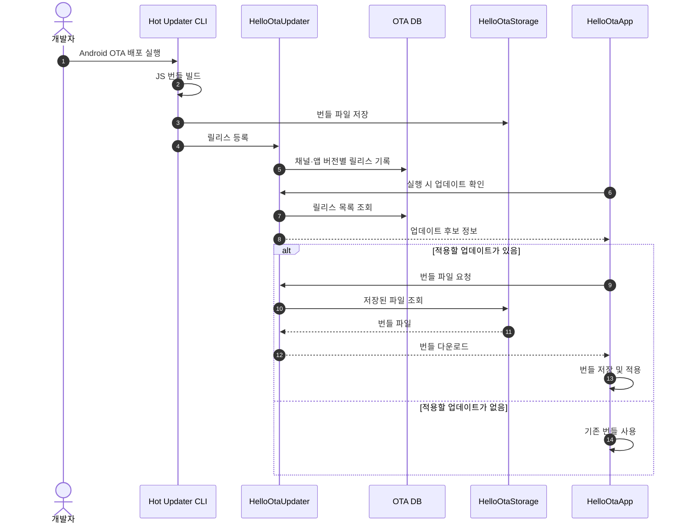

# Hello OTA

React Native 앱의 OTA 업데이트를 시험하는 프로젝트입니다. 앱은 Hot Updater로 JS 번들을 확인하고, 별도 API에서 화면 데이터를 가져옵니다.

## 구성

- `HelloOtaApp`: React Native 앱 및 OTA 배포 CLI 설정
- `HelloOtaUpdater`: OTA 조회·관리 API와 릴리스 정보 관리
- `HelloOtaStorage`: 배포된 번들 파일 저장소
- `HelloOtaApi`: 앱 화면 데이터 API

## OTA 시퀀스

앱은 `appVersion` 전략을 사용하며, Android 기본 채널은 `ota-test`입니다. 일반 화면 데이터 요청은 `HelloOtaApi`가 별도로 처리합니다.

자세한 구조와 API 흐름은 [OTA_SEQUENCE.md](OTA_SEQUENCE.md)를 참고하세요.
